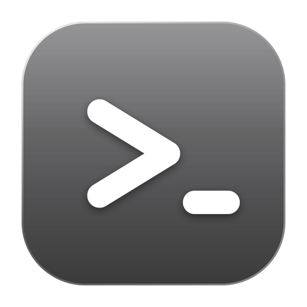
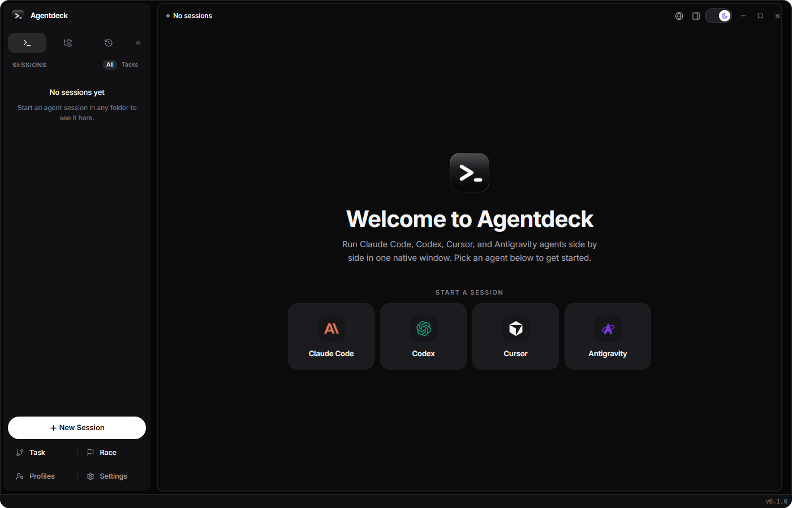
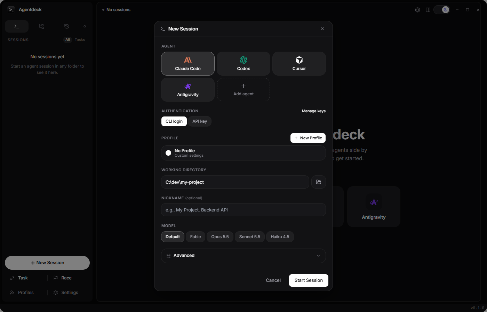
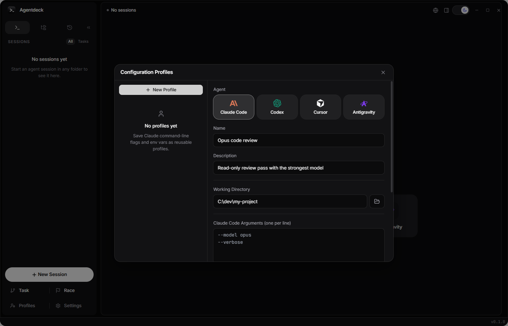
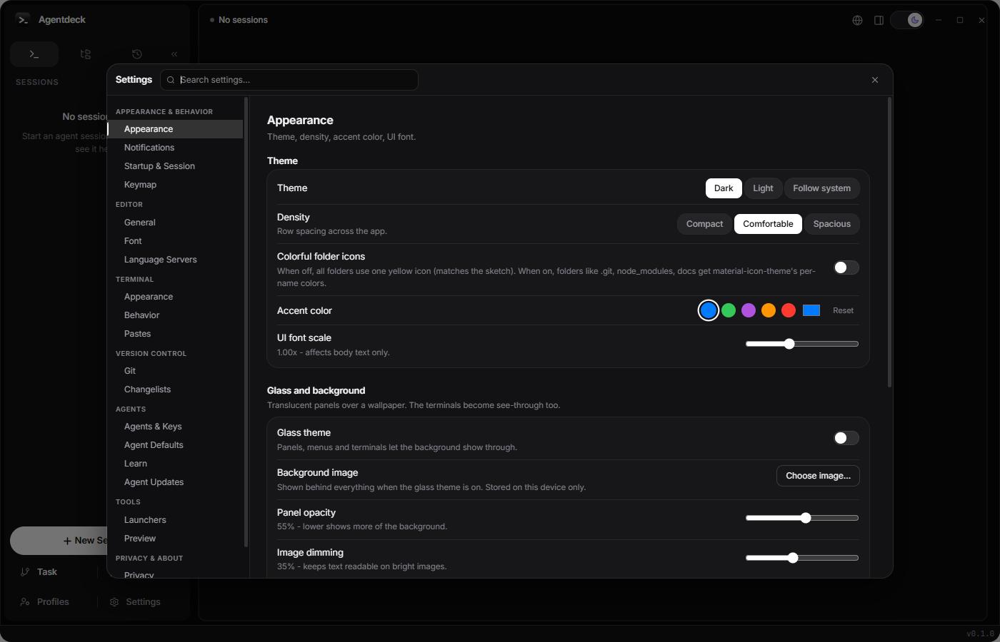

<p align="center">
  
</p>

<h1 align="center">Agentdeck</h1>

<p align="center">
  <strong>One desktop window for all your coding agents.</strong><br>
  Run Claude Code, Codex, Cursor and Antigravity side by side, each in its own terminal.
</p>

<p align="center">
  
  
  
  
</p>

<p align="center">
  
</p>

## Why Agentdeck

Coding agents live in the terminal, and the terminal is a poor place to juggle
five of them. Agentdeck gives every agent a real PTY, then adds what a plain
terminal does not: tabs and a grid, saved profiles, git worktrees per task,
side-by-side comparison, and a place to review what the agents changed.

Everything runs locally. There is no account, no sign-in, no sync, and no
telemetry. Your sessions, profiles and API keys stay on your machine.

## Features

**Sessions**
- Four agents out of the box (Claude Code, Codex, Cursor, Antigravity), plus your own custom CLIs
- Tabs with pin, reorder and tear-off, or a grid of up to 8 sessions
- Session restore: reattaches agent conversations after a restart
- Automatic subtitles taken from local session metadata, with no extra AI calls

**Work in parallel**
- **Task**: starts an agent in its own git worktree and branch, then merges or discards it when done
- **Race**: runs the same prompt with 2 to 4 agents or models from one base commit, then compares the results and merges the winner
- **Pull requests**: create a PR through your own `gh` or `glab` CLI, and hand a failing CI run back to an agent
- **Handoff**: continue a session in another agent with a brief of the task and current changes

**Around the terminal**
- Built-in browser with tabs and bookmarks, split beside any session
- File editor and hunk-level diff review next to the terminal
- Attention inbox for prompts waiting on you, finished runs and failures
- System tray icon showing how many agents are working or waiting
- Command palette, prompt editor, snippets and a Claude Code command reference

**Yours to configure**
- Profiles with working directory, per-agent arguments and environment variables
- API keys stored in the OS credential store, never in the database
- Dark, light or system theme, accent color, density, font scale
- Glass theme with your own background image, and Zen mode (`Ctrl+Alt+Z`) to hide every panel

## Screenshots

<p align="center">
  
  <br><em>Pick an agent, an authentication mode, a profile, a folder and a model</em>
</p>

<p align="center">
  
  <br><em>Profiles keep arguments and environment variables per agent</em>
</p>

<p align="center">
  
  <br><em>Settings: theme, density, accent color, glass and background image</em>
</p>

## Supported agents

| Agent | Binary | Install |
|---|---|---|
| **Claude Code** | `claude` | `npm install -g @anthropic-ai/claude-code` |
| **Codex** | `codex` | `npm install -g @openai/codex` |
| **Cursor** | `agent` | `curl https://cursor.com/install -fsS \| bash` |
| **Antigravity** | `agy` | `curl -fsSL https://antigravity.google/cli/install.sh \| bash` |

Agentdeck launches the agents you already have installed. You need at least one
of them on your `PATH`; the others are picked up automatically once installed.

## Install

Download the installer for your platform from the
[Releases page](https://github.com/momentxrdd/agentdeck/releases):

- **Windows**: `.exe` (NSIS) or `.msi`
- **macOS**: `.dmg` for Apple Silicon or Intel

The builds are not code-signed yet, so the first launch needs one extra step:

- **Windows**: SmartScreen shows "Windows protected your PC". Click **More info**, then **Run anyway**.
- **macOS**: Gatekeeper may report the app as damaged. Clear the quarantine flag, then open it normally:
  ```bash
  xattr -cr /Applications/Agentdeck.app
  ```

There is no in-app auto-update. To update, download the newer installer.

## Build from source

You need [Node.js](https://nodejs.org/) 22+, [Rust](https://rustup.rs/) (stable), and on Windows the
[Visual Studio Build Tools](https://visualstudio.microsoft.com/visual-cpp-build-tools/).

```bash
git clone https://github.com/momentxrdd/agentdeck.git
cd agentdeck
npm install
npm run tauri dev      # run with hot reload
npm run tauri build    # produce installers in src-tauri/target/release/bundle/
```

Run the checks with `npx tsc --noEmit`, `npm run test:run` and, from `src-tauri/`, `cargo test`.

## Keyboard shortcuts

| Shortcut | Action |
|---|---|
| `Ctrl+Shift+N` | New session |
| `Ctrl+Shift+D` | Duplicate current session |
| `Ctrl+W` | Close current session |
| `Ctrl+Tab` / `Ctrl+Shift+Tab` | Next / previous session |
| `Ctrl+G` | Toggle grid view |
| `Ctrl+Shift+G` | Add current session to the grid |
| `Ctrl+B` | Toggle sidebar |
| `Ctrl+P` | Search everywhere |
| `Ctrl+Alt+Z` | Zen mode |
| `Ctrl+,` | Settings |
| `F1` | Command hints |

On macOS, use `Cmd` in place of `Ctrl`.

## Troubleshooting

**An agent shows "Not installed".** Check that its binary is on `PATH` (`where claude`, `which codex`),
restart Agentdeck so it inherits the updated `PATH`, then press **Recheck** in Settings > Agent Updates.

**A session opens but the agent asks you to log in.** Each agent has its own login. Run it once in a
normal terminal, or choose the **API key** option in the New Session dialog.

**Build fails.** Run `rustup update`, then `cargo clean` inside `src-tauri/` and build again.

## Tech stack

Tauri 2 and Rust on the backend (`portable-pty`, SQLite via `rusqlite`, OS keychain via `keyring`),
React 18 with TypeScript, Tailwind CSS and Zustand on the frontend, and xterm.js for terminal rendering.

## Contributing

Issues and pull requests are welcome. Fork the repository, create a branch, make sure
`npx tsc --noEmit`, `npm run test:run` and `cargo test` pass, and open a pull request.

## License

MIT. See [LICENSE](LICENSE).
